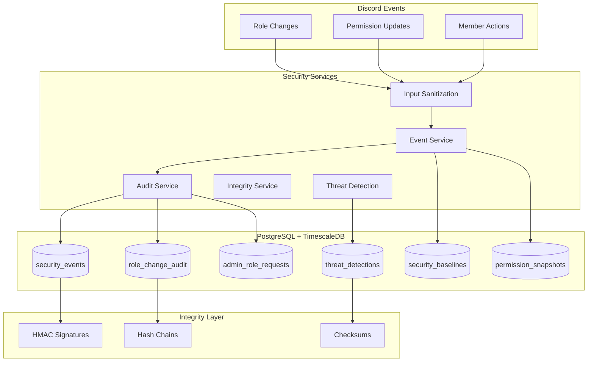
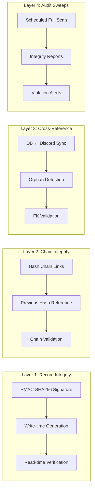
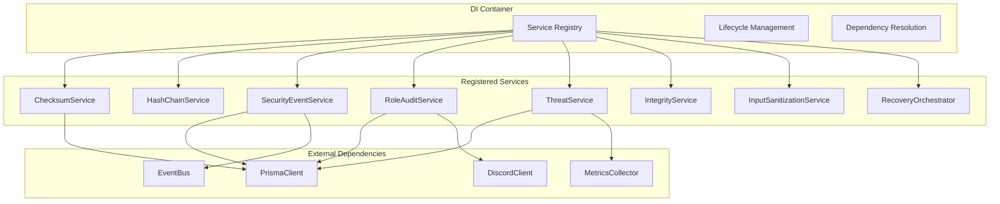
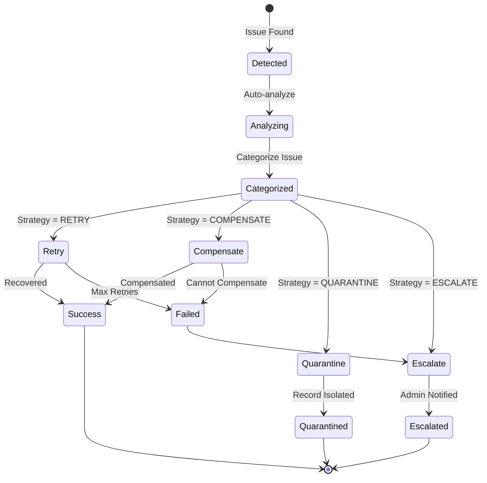
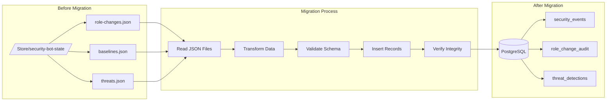

````markdown
# Section 21: Security Database Architecture

**Last Updated**: 2026-04-03 | **Status**: Production | **Phase 1**: ✅ Complete (2025-12-27)

[← Back to INDEX](INDEX.md) | [← Previous: Resource Limits](20-resource-limits.md) | [Next: Future Roadmap →](14-future-roadmap.md)

---

**Philosophy**: "Trust, but verify. Every security event is evidence; every change is audited; every access is authenticated."

**Purpose**: Comprehensive security data persistence with integrity guarantees, audit trails, and threat intelligence.

**Project**: Security Bot Database Transformation (December 2025)

---

## 21.1 Architecture Overview

The security database implements a multi-layer architecture for capturing, validating, and analyzing security events across the Discord bot infrastructure.



## 21.2 Data Models

### 21.2.1 Security Events

The foundational event model captures all security-relevant activities.

```typescript
interface SecurityEvent {
  id: string;                    // UUID v7 (time-ordered)
  eventType: SecurityEventType;  // Enum: ROLE_CHANGE, PERMISSION_UPDATE, etc.
  severity: EventSeverity;       // Enum: INFO, WARNING, ERROR, CRITICAL
  guildId: string;               // Discord guild snowflake
  memberId?: string;             // Affected member (optional)
  actorId?: string;              // Who initiated the action
  details: Record<string, any>;  // Event-specific payload
  timestamp: Date;               // Event occurrence time
  checksum: string;              // HMAC-SHA256 integrity signature
  previousHash?: string;         // Hash chain link
  createdAt: Date;               // Database insert time
}
```

**Event Types**:

| Type | Description | Severity |
|------|-------------|----------|
| `ROLE_GRANTED` | Role added to member | INFO |
| `ROLE_REVOKED` | Role removed from member | INFO |
| `PERMISSION_CHANGED` | Role permission updated | WARNING |
| `UNAUTHORIZED_ACCESS` | Access denied event | WARNING |
| `THREAT_DETECTED` | Security threat identified | ERROR |
| `INTEGRITY_VIOLATION` | Data tampering detected | CRITICAL |
| `BASELINE_EXCEEDED` | Activity exceeds normal | WARNING |
| `ADMIN_ACTION` | Administrative operation | INFO |

### 21.2.2 Role Change Audit

Complete audit trail for all role modifications.

```typescript
interface RoleChangeAudit {
  id: string;                    // UUID v7
  guildId: string;               // Discord guild
  memberId: string;              // Affected member
  roleId: string;                // Discord role
  changeType: ChangeType;        // ADD, REMOVE, MODIFY
  oldPermissions?: bigint;       // Previous permission bitfield
  newPermissions?: bigint;       // New permission bitfield
  authorized: boolean;           // Was change authorized?
  authorizedBy?: string;         // Approver member ID
  reason?: string;               // Change justification
  reverted: boolean;             // Was change reverted?
  revertReason?: string;         // Why reverted
  origin: string;                // Source of the change (see Origin Values)
  eventId: string;               // Link to SecurityEvent
  checksum: string;              // Integrity signature
  previousAuditHash: string;     // Hash chain for audit trail
  timestamp: Date;
}
```

**Origin Values** — The `origin` field classifies how the role change was initiated:

| Origin | Source | Description |
|--------|--------|-------------|
| `sweep` | Continuous sweep worker | Detected during periodic guild scans |
| `member-join` | Guild member join event | Auto-role on new member |
| `member-update` | guildMemberUpdate event | Manual role change by admin/mod |
| `admin-manual` | Admin CLI / dashboard | Operator-initiated change |
| `security-bot-revert` | Security bot | Unauthorized change automatically reverted |
| `moderator-channel-sync` | channelUpdate / boot sync | **Gym Leader role** granted/revoked based on 👑moderator-only👑 channel access (added 2026-04-03) |
| `role-reaction` | Reaction role system | User self-assigned via reaction |

### 21.2.3 Threat Detection

Records for identified security threats with evidence.

```typescript
interface ThreatDetection {
  id: string;                    // UUID v7
  threatType: ThreatType;        // RAID, MASS_MENTION, PERMISSION_ESCALATION, etc.
  severity: ThreatSeverity;      // LOW, MEDIUM, HIGH, CRITICAL
  guildId: string;
  sourceId?: string;             // Source member/channel
  evidence: Evidence[];          // Supporting data
  status: ThreatStatus;          // DETECTED, INVESTIGATING, RESOLVED, FALSE_POSITIVE
  resolvedAt?: Date;
  resolvedBy?: string;
  notes?: string;
  eventIds: string[];            // Related security events
  checksum: string;
  timestamp: Date;
}

interface Evidence {
  type: EvidenceType;            // MESSAGE, ROLE_CHANGE, JOIN_PATTERN, etc.
  data: Record<string, any>;
  collectedAt: Date;
}
```

### 21.2.4 Security Baselines

Per-guild normal activity baselines for anomaly detection.

```typescript
interface SecurityBaseline {
  id: string;                    // UUID v7
  guildId: string;               // Discord guild
  metricType: MetricType;        // ROLE_CHANGES_HOUR, JOINS_MINUTE, etc.
  averageValue: number;          // Calculated average
  standardDeviation: number;     // For anomaly detection
  sampleCount: number;           // Data points used
  confidenceLevel: number;       // 0-1 confidence score
  lastCalculated: Date;
  expiresAt: Date;               // Baseline validity period
  checksum: string;
}
```

### 21.2.5 Permission Snapshots

Point-in-time captures of guild permission state.

```typescript
interface PermissionSnapshot {
  id: string;                    // UUID v7
  guildId: string;
  snapshotType: SnapshotType;    // SCHEDULED, MANUAL, PRE_CHANGE
  roles: RoleSnapshot[];         // All roles and permissions
  members: MemberSnapshot[];     // All member role assignments
  channels: ChannelSnapshot[];   // Channel permission overwrites
  signature: string;             // Cryptographic signature
  previousSnapshotId?: string;   // For diffing
  takenAt: Date;
  takenBy?: string;              // SYSTEM or member ID
}
```

## 21.3 Integrity System

### 21.3.1 Multi-Layer Validation



### 21.3.2 HMAC Signatures (Timing-Safe)

All security records include cryptographic signatures to detect tampering.

```typescript
// src/bot/security/services/checksum-service.ts
class ChecksumService {
  private readonly key: Buffer;
  
  constructor(signingKey: string) {
    this.key = Buffer.from(signingKey, 'hex');
  }
  
  /**
   * Generate HMAC-SHA256 signature for record
   * Uses canonical JSON serialization for consistency
   */
  generateChecksum(data: Record<string, any>): string {
    const canonical = this.canonicalize(data);
    return crypto
      .createHmac('sha256', this.key)
      .update(canonical)
      .digest('hex');
  }
  
  /**
   * Timing-safe signature verification (CWE-208 compliant)
   */
  verifyChecksum(data: Record<string, any>, expected: string): boolean {
    const actual = this.generateChecksum(data);
    return crypto.timingSafeEqual(
      Buffer.from(actual, 'hex'),
      Buffer.from(expected, 'hex')
    );
  }
  
  /**
   * Canonical JSON serialization for deterministic signatures
   */
  private canonicalize(obj: Record<string, any>): string {
    const sorted = Object.keys(obj).sort().reduce((acc, key) => {
      if (key !== 'checksum') {
        acc[key] = obj[key];
      }
      return acc;
    }, {} as Record<string, any>);
    return JSON.stringify(sorted);
  }
}
```

### 21.3.3 Hash Chains (Immutable Audit Trail)

Audit records form a cryptographic chain for tamper detection.

```typescript
// src/bot/security/services/hash-chain-service.ts
class HashChainService {
  /**
   * Generate hash for new record in chain
   */
  generateHash(
    currentData: Record<string, any>,
    previousHash: string | null
  ): string {
    const content = JSON.stringify({
      data: currentData,
      previous: previousHash ?? 'GENESIS'
    });
    return crypto.createHash('sha256').update(content).digest('hex');
  }
  
  /**
   * Validate entire chain integrity
   */
  async validateChain(records: AuditRecord[]): Promise<ChainValidation> {
    const violations: ChainViolation[] = [];
    let previousHash: string | null = null;
    
    for (const record of records) {
      const expectedHash = this.generateHash(
        this.extractData(record),
        previousHash
      );
      
      if (record.hash !== expectedHash) {
        violations.push({
          recordId: record.id,
          expected: expectedHash,
          actual: record.hash,
          position: records.indexOf(record)
        });
      }
      
      previousHash = record.hash;
    }
    
    return {
      valid: violations.length === 0,
      violations,
      chainLength: records.length
    };
  }
}
```

## 21.4 Service Architecture

### 21.4.1 Dependency Injection Container

All security services use a centralized DI container for testability and configuration.



```typescript
// src/bot/security/di/container.ts
class DIContainer {
  private readonly services = new Map<string, any>();
  private readonly factories = new Map<string, () => any>();
  
  register<T>(token: string, factory: () => T, options?: RegisterOptions): void {
    if (options?.singleton) {
      this.services.set(token, factory());
    } else {
      this.factories.set(token, factory);
    }
  }
  
  resolve<T>(token: string): T {
    if (this.services.has(token)) {
      return this.services.get(token);
    }
    if (this.factories.has(token)) {
      return this.factories.get(token)!();
    }
    throw new Error(`Service not registered: ${token}`);
  }
  
  async shutdown(): Promise<void> {
    for (const [token, service] of this.services) {
      if (typeof service.shutdown === 'function') {
        await service.shutdown();
      }
    }
  }
}
```

### 21.4.2 Event Bus Integration

Security services communicate through a typed event bus.

```typescript
// Event channels
type SecurityChannel = 
  | 'THREAT'        // Threat detection events
  | 'ROLE_CHANGE'   // Role modification events
  | 'BASELINE'      // Baseline violation events
  | 'AUDIT'         // Audit trail events
  | 'INTEGRITY'     // Integrity check events
  | 'ALERT';        // Admin alert events

// Event structure
interface SecurityBusEvent<T = any> {
  id: string;                    // Event UUID
  channel: SecurityChannel;
  type: string;                  // Specific event type
  priority: 'CRITICAL' | 'HIGH' | 'MEDIUM' | 'LOW';
  payload: T;
  metadata: {
    guildId?: string;
    timestamp: Date;
    correlationId?: string;
  };
}
```

### 21.4.3 Rate Limiting (Token Bucket)

All security operations are rate-limited to prevent abuse.

```typescript
// src/bot/security/services/rate-limiter.ts
class TokenBucketRateLimiter {
  private buckets = new Map<string, TokenBucket>();
  
  constructor(private config: RateLimitConfig) {}
  
  /**
   * Check if action is allowed
   * @returns tokens remaining, or -1 if rate limited
   */
  consume(key: string, tokens: number = 1): number {
    const bucket = this.getBucket(key);
    
    // Refill based on time elapsed
    const now = Date.now();
    const elapsed = now - bucket.lastRefill;
    const refillAmount = (elapsed / 1000) * this.config.refillRate;
    bucket.tokens = Math.min(
      this.config.maxTokens,
      bucket.tokens + refillAmount
    );
    bucket.lastRefill = now;
    
    // Check and consume
    if (bucket.tokens >= tokens) {
      bucket.tokens -= tokens;
      return bucket.tokens;
    }
    
    return -1; // Rate limited
  }
  
  /**
   * Get wait time until tokens available
   */
  getWaitTime(key: string, tokens: number = 1): number {
    const bucket = this.getBucket(key);
    const needed = tokens - bucket.tokens;
    if (needed <= 0) return 0;
    return (needed / this.config.refillRate) * 1000;
  }
}
```

## 21.5 Recovery & Resilience

### 21.5.1 Recovery Orchestrator

Automated recovery for integrity violations and operational issues.



**Recovery Strategies**:

| Strategy | Issue Type | Action |
|----------|-----------|--------|
| RETRY | Transient failures | Retry with backoff |
| COMPENSATE | Data inconsistency | Apply compensating action |
| QUARANTINE | Integrity violation | Isolate and flag record |
| ESCALATE | Critical security | Alert admins immediately |
| ALERT | Non-critical | Log and monitor |

### 21.5.2 Circuit Breaker Pattern

External service calls (Discord API, PagerDuty) use circuit breakers.

```typescript
// States: CLOSED → OPEN → HALF_OPEN → CLOSED
class CircuitBreaker {
  private state: 'CLOSED' | 'OPEN' | 'HALF_OPEN' = 'CLOSED';
  private failures = 0;
  private lastFailure?: Date;
  
  async execute<T>(operation: () => Promise<T>): Promise<T> {
    if (this.state === 'OPEN') {
      if (this.shouldAttemptReset()) {
        this.state = 'HALF_OPEN';
      } else {
        throw new CircuitOpenError(this.getWaitTime());
      }
    }
    
    try {
      const result = await operation();
      this.onSuccess();
      return result;
    } catch (error) {
      this.onFailure();
      throw error;
    }
  }
  
  private onSuccess(): void {
    this.failures = 0;
    this.state = 'CLOSED';
  }
  
  private onFailure(): void {
    this.failures++;
    this.lastFailure = new Date();
    
    if (this.failures >= this.config.failureThreshold) {
      this.state = 'OPEN';
    }
  }
}
```

## 21.6 Observability

### 21.6.1 Metrics (Prometheus)

```typescript
// Exposed metrics
const securityMetrics = {
  // Event counts
  events_total: new Counter({
    name: 'security_events_total',
    help: 'Total security events by type and severity',
    labelNames: ['event_type', 'severity', 'guild_id']
  }),
  
  // Integrity checks
  integrity_checks_total: new Counter({
    name: 'security_integrity_checks_total',
    help: 'Integrity validation attempts',
    labelNames: ['check_type', 'result']
  }),
  
  // Threat detection
  threats_detected_total: new Counter({
    name: 'security_threats_detected_total',
    help: 'Threats detected by type',
    labelNames: ['threat_type', 'severity']
  }),
  
  // Rate limiting
  rate_limit_hits_total: new Counter({
    name: 'security_rate_limit_hits_total',
    help: 'Rate limit violations',
    labelNames: ['operation', 'user_tier']
  }),
  
  // Operation latency
  operation_duration_seconds: new Histogram({
    name: 'security_operation_duration_seconds',
    help: 'Security operation latency',
    labelNames: ['operation'],
    buckets: [0.001, 0.005, 0.01, 0.05, 0.1, 0.5, 1]
  })
};
```

### 21.6.2 Health Checks

```typescript
interface SecurityHealthStatus {
  healthy: boolean;
  components: {
    database: ComponentHealth;
    discord: ComponentHealth;
    integrityService: ComponentHealth;
    eventBus: ComponentHealth;
    rateLimiter: ComponentHealth;
  };
  lastCheck: Date;
  uptime: number;
}

// Health endpoint: GET /ops/security/health
app.get('/ops/security/health', async (req, res) => {
  const health = await securityHealthService.check();
  const status = health.healthy ? 200 : 503;
  res.status(status).json(health);
});
```

## 21.7 Testing Architecture

### 21.7.1 Test Coverage Summary

| Test Suite | Tests | Coverage |
|------------|-------|----------|
| Security Event Service | 61 | 95% |
| Role Audit Service | 58 | 92% |
| Threat Detection Service | 54 | 90% |
| Checksum Service | 47 | 100% |
| Hash Chain Service | 43 | 100% |
| Input Sanitization | 129 | 98% |
| Cross-Reference Validation | 53 | 88% |
| Integrity Sweep Scheduler | 57 | 85% |
| Security Event Bus | 52 | 90% |
| Recovery Orchestrator | 50 | 87% |
| DI Container | 82 | 95% |
| Property-Based Tests | 40 | N/A |
| Security Penetration Tests | 138 | N/A |
| E2E Command Tests | 126 | N/A |
| **Total** | **1,543** | **~92%** |

### 21.7.2 Property-Based Testing

Security invariants verified with fast-check:

```typescript
// Invariants tested:
// 1. Checksum determinism: same input → same output
// 2. Timing-safe comparison: no timing side-channels
// 3. Hash chain integrity: valid chains always verify
// 4. Input sanitization: no XSS/SQL injection possible
// 5. Rate limiting: never exceeds configured limits
// 6. Event ordering: events always chronologically ordered
```

### 21.7.3 Snapshot Testing

Configuration snapshots for regression detection:

```typescript
// Snapshots captured:
// - Security event type definitions
// - Severity level mappings
// - Service configuration defaults
// - API response structures
// - Database schema patterns
// - Discord embed structures
```

## 21.8 Migration Path

### 21.8.1 From JSON to Database



### 21.8.2 Rollback Strategy

```typescript
// Migration can be rolled back at any checkpoint
interface MigrationCheckpoint {
  id: string;
  phase: 'SCHEMA' | 'DATA' | 'INTEGRITY' | 'ACTIVATION';
  status: 'PENDING' | 'COMPLETE' | 'FAILED';
  rollbackScript: string;
  createdAt: Date;
}

// Automated rollback on failure
async function rollbackMigration(checkpoint: MigrationCheckpoint): Promise<void> {
  const rollbackSteps = await getRollbackSteps(checkpoint);
  
  for (const step of rollbackSteps.reverse()) {
    await executeRollbackStep(step);
    await verifyRollback(step);
  }
  
  await restoreJsonState();
}
```

## 21.9 Configuration Reference

### 21.9.1 Environment Variables

```bash
# Signing and encryption
SECURITY_SIGNING_KEY=<64-char-hex>      # HMAC signing key
SECURITY_ENCRYPTION_KEY=<64-char-hex>   # AES-256 encryption key

# Rate limiting
SECURITY_RATE_LIMIT_MAX_TOKENS=100      # Max tokens per bucket
SECURITY_RATE_LIMIT_REFILL_RATE=10      # Tokens per second

# Integrity
SECURITY_INTEGRITY_SWEEP_INTERVAL=3600000   # 1 hour
SECURITY_BASELINE_EXPIRY_DAYS=7
SECURITY_SNAPSHOT_RETENTION_DAYS=30

# Alerting
PAGERDUTY_ROUTING_KEY=<routing-key>
SECURITY_ALERT_COOLDOWN_MS=300000       # 5 minutes

# Feature flags
SECURITY_HASH_CHAIN_ENABLED=true
SECURITY_CONTINUOUS_AGGREGATES_ENABLED=true
SECURITY_EVENT_SOURCING_ENABLED=true
```

### 21.9.2 Service Configuration

```typescript
const defaultSecurityConfig: SecurityConfig = {
  // Checksums
  checksumAlgorithm: 'sha256',
  signatureKeyRotationDays: 90,
  
  // Rate limiting
  rateLimiting: {
    defaultBucket: { maxTokens: 100, refillRate: 10 },
    adminBucket: { maxTokens: 500, refillRate: 50 },
    systemBucket: { maxTokens: 1000, refillRate: 100 }
  },
  
  // Integrity
  integrity: {
    checksumVerificationEnabled: true,
    hashChainValidationEnabled: true,
    crossReferenceCheckInterval: 86400000, // 24h
    fullAuditSweepInterval: 604800000      // 7 days
  },
  
  // Recovery
  recovery: {
    maxRetries: 3,
    retryBackoffMs: 1000,
    quarantineEnabled: true,
    autoEscalateAfterMs: 300000 // 5 min
  },
  
  // Observability
  observability: {
    metricsEnabled: true,
    tracingEnabled: true,
    auditLoggingEnabled: true
  }
};
```

## 21.10 ADR References

Architecture decisions documented:

- **[ADR-001: TimescaleDB Selection](../projects/security-db-transformation/ADR-001-timescaledb-selection.md)** — Why TimescaleDB for time-series security data
- **[ADR-002: Event Sourcing](../projects/security-db-transformation/ADR-002-event-sourcing.md)** — Event sourcing for complete audit trail
- **[ADR-003: Security Taxonomy](../projects/security-db-transformation/ADR-003-security-taxonomy.md)** — Standardized security event classification

---

## 21.11 Quick Reference

**Start Integrity Check**:
```bash
npm run ops:security:integrity-check
```

**View Security Events**:
```bash
npm run db:cli -- query "SELECT * FROM security_events ORDER BY timestamp DESC LIMIT 10"
```

**Validate Hash Chain**:
```bash
npm run ops:security:validate-chain --table role_change_audit
```

**Generate Baseline Report**:
```bash
npm run ops:security:baseline-report --guild <guild-id>
```

---

[← Back to INDEX](INDEX.md) | [← Previous: Resource Limits](20-resource-limits.md) | [Next: Future Roadmap →](14-future-roadmap.md)
````