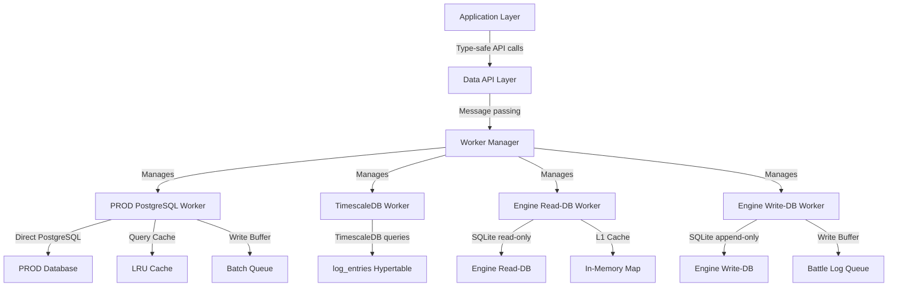

# Database Centralization Plan — Async Worker Architecture

**Status:** 🚧 IN PROGRESS (Task 1 of 12)  
**Created:** 2025-12-02  
**Last Updated:** 2025-12-02  
**Goal:** Centralize all database access through dedicated asynchronous workers with caching and buffering

---

## Executive Summary

**Problem:** Current architecture has database access scattered across application code with:
- Multiple Prisma client instances (3 clients: PROD, Local Dev, Experiment)
- Direct database queries in battle engine, encounter system, admin commands
- Mixed responsibility (engine-workers.ts manages 4 different workers)
- No unified caching/buffering strategy
- Inconsistent error handling across database operations

**Solution:** Implement centralized database worker architecture where:
- **Each database gets a dedicated async worker** (PROD PostgreSQL, TimescaleDB, Engine Read-DB, Engine Write-DB)
- **Workers handle all database I/O** (connections, queries, caching, buffering, health monitoring)
- **Application code uses clean APIs** (no direct Prisma imports, type-safe query methods)
- **Unified monitoring and observability** (worker health dashboard, query performance, cache metrics)

**Benefits:**
- ✅ **Clean separation of concerns** — Application logic decoupled from database operations
- ✅ **Improved performance** — Intelligent caching, query batching, connection pooling
- ✅ **Better reliability** — Automatic reconnection, error recovery, health monitoring
- ✅ **Easier testing** — Mock workers for unit tests, real workers for integration tests
- ✅ **Enhanced observability** — Per-worker metrics, slow query detection, cache hit rates

---

## Current Architecture Audit

### Database Connections (As of 2025-12-02)

```
┌─────────────────────────────────────────────────────────────────────────┐
│ PRODUCTION DATABASES (Render Managed)                                   │
├─────────────────────────────────────────────────────────────────────────┤
│                                                                          │
│  1. PROD PostgreSQL (PRIMARY - REQUIRED)                                │
│     URL: PROD_DATABASE_URL                                              │
│     Prisma Client: prisma                                               │
│     Purpose: All production operations (battles, encounters, profiles)  │
│     Connection: Direct PostgreSQL (no pooling)                          │
│     Transport: "direct"                                                 │
│     Status: ✅ OPERATIONAL                                              │
│                                                                          │
│  2. TimescaleDB Hypertables (PROD PostgreSQL extension)                 │
│     Extension: timescaledb 2.23.0 (Apache license)                     │
│     Hypertables:                                                        │
│       - log_entries (system logs)                                       │
│       - event_history (event bus events)                                │
│       - security_events (permission changes, role edits)                │
│       - battle_analytics (battle outcomes, move usage)                  │
│     Materialized Views:                                                 │
│       - logs_hourly (1h buckets, log volume by level/category)         │
│       - error_rate_hourly (error % by service)                          │
│       - battles_daily (1d buckets, completion rate/duration)            │
│       - security_events_daily (1d buckets, events by type/severity)    │
│       - pokemon_usage_weekly (1w buckets, usage with win rates)        │
│     Worker: log-ingestion-worker.ts (Event Bus → log_entries)          │
│     Status: ✅ OPERATIONAL (0 rows - awaiting bot deployment)           │
│                                                                          │
└─────────────────────────────────────────────────────────────────────────┘

┌─────────────────────────────────────────────────────────────────────────┐
│ LOCAL DATABASES (Workstation Development - OPTIONAL)                    │
├─────────────────────────────────────────────────────────────────────────┤
│                                                                          │
│  3. Local Dev PostgreSQL (OPTIONAL - Workstation Only)                  │
│     URL: DATABASE_ONPREMISE_DEV_PRIMARY                                 │
│     Prisma Client: onPremiseDevPrisma                                   │
│     Purpose: Offline development fallback                               │
│     Port: 55433                                                         │
│     Store: Store/onpremise-dev-primary/                                 │
│     Status: ⚪ OPTIONAL (null if not configured)                        │
│                                                                          │
│  4. Experiment PostgreSQL (OPTIONAL - Migration Testing)                │
│     URL: DATABASE_ONPREMISE_DEV_EXPERIMENT                              │
│     Prisma Client: onPremiseExperimentPrisma                            │
│     Purpose: Migration validation (isolated experiments)                │
│     Port: 55434                                                         │
│     Store: Store/onpremise-dev-primary-experiment/                      │
│     Status: ⚪ OPTIONAL (null if not configured)                        │
│                                                                          │
└─────────────────────────────────────────────────────────────────────────┘

┌─────────────────────────────────────────────────────────────────────────┐
│ ENGINE DATABASES (SQLite - Battle Engine Runtime)                       │
├─────────────────────────────────────────────────────────────────────────┤
│                                                                          │
│  5. Engine Read-DB (SQLite - Read-Only)                                 │
│     Location: /Store/engine-read-db.sqlite (prod)                       │
│               Store/engine-read-db.sqlite (local)                        │
│     Purpose: Ultra-fast local Pokémon data lookup                       │
│     Schema:                                                             │
│       - pokemon (ID, name, types, stats, abilities)                     │
│       - moves (ID, name, type, power, accuracy)                         │
│       - type_effectiveness (attack type, defense type, multiplier)      │
│     L1 Cache: In-memory Map (20 MB max, <1μs latency)                   │
│     Worker: CacheRefreshWorker (hourly refresh from Read-DB)            │
│     Status: ✅ OPERATIONAL                                              │
│                                                                          │
│  6. Engine Write-DB (SQLite - Append-Only)                              │
│     Location: /Store/engine-write-db.sqlite (prod)                      │
│               Store/engine-write-db.sqlite (local)                       │
│     Purpose: Battle outcome logging, move usage tracking                │
│     Schema:                                                             │
│       - battle_logs (ID, trainer IDs, outcome, duration, moves)         │
│       - move_usage (move ID, damage dealt, effectiveness)               │
│       - anomalies (unusual patterns, validation failures)               │
│       - write_ahead_log (WAL for crash recovery)                        │
│     Write Buffer: In-memory queues (10k max, <10μs push latency)        │
│     Workers:                                                            │
│       - BufferFlushWorker (30s flush to Write-DB)                       │
│       - WriteDbValidatorWorker (10min validate → upload → prune)        │
│     Status: ✅ OPERATIONAL                                              │
│                                                                          │
└─────────────────────────────────────────────────────────────────────────┘
```

### Current Workers (As of 2025-12-02)

```typescript
// src/workers/engine-workers.ts (655 lines)
// Manages 4 workers for Engine DB runtime

export interface EngineWorkersStatus {
  cacheRefresh: WorkerStatus;      // Refresh L1 cache from Read-DB (hourly)
  bufferFlush: WorkerStatus;        // Flush Write Buffer to Write-DB (30s)
  readDbSync: WorkerStatus;         // Sync Read-DB from PROD (daily, Render cron)
  writeDbValidator: WorkerStatus;   // Validate → Upload → Prune (10min)
  maintenance: WorkerStatus;        // General maintenance tasks
}

// src/workers/log-ingestion-worker.ts (300+ lines)
// Event Bus → TimescaleDB log_entries pipeline
// Batch processing: 100 events per 5 minutes
// Fallback: File writes on database outage

// src/workers/error-learning-worker.ts (hourly analysis)
// Analyzes error patterns from ErrorLog table (PROD PostgreSQL)
// Machine learning for error categorization and prediction
```

### Current Database Access Patterns

**Direct Prisma Access** (scattered across codebase):
- `src/commands/battle.ts` — Battle state CRUD
- `src/commands/encounter.ts` — Wild Pokémon encounter CRUD
- `src/commands/profile.ts` — Trainer profile queries
- `src/bot/ops/admin.ts` — Admin commands (user queries, stats)
- `src/data_pipeline/` — Data ingestion (PokéAPI → PostgreSQL)

**Engine DB Access** (centralized through Service Registry):
- `src/services/cache/engine-cache.ts` — L1 Cache (read-only, Map data structure)
- `src/services/cache/engine-write-buffer.ts` — Write Buffer (write-only, array queues)
- `src/services/database/engine-read-db.ts` — Read-DB interface (SQLite queries)
- `src/services/database/engine-write-db.ts` — Write-DB interface (SQLite inserts)

**Problems Identified:**
1. ❌ **Mixed responsibility** — Application code directly calls Prisma (bypasses caching/buffering)
2. ❌ **No unified API** — Each developer must know which Prisma client to use (prisma vs onPremiseDevPrisma)
3. ❌ **Inconsistent error handling** — Database errors handled differently across modules
4. ❌ **No query optimization** — Direct queries miss opportunities for batching, caching
5. ❌ **Poor testability** — Hard to mock database access in unit tests

---

## Target Architecture — Centralized Database Workers

### Design Principles

1. **One Worker Per Database** — Each database gets dedicated worker managing all I/O
2. **Workers Own Connections** — Application never directly creates Prisma clients
3. **Clean API Layer** — Type-safe APIs hide database complexity from application
4. **Intelligent Caching** — Workers cache frequently accessed data (with TTL)
5. **Batch Processing** — Workers buffer writes for efficient batch inserts
6. **Health Monitoring** — Workers track latency, throughput, error rates
7. **Graceful Degradation** — Workers handle connection loss, retry with backoff

### Worker Architecture Diagram

```
┌──────────────────────────────────────────────────────────────────────────┐
│                         APPLICATION LAYER                                 │
│  (Battle Engine, Encounter System, Admin Commands, etc.)                 │
└────────────────────────────┬─────────────────────────────────────────────┘
                             │
                             │ Type-safe API calls (no Prisma imports)
                             ▼
┌──────────────────────────────────────────────────────────────────────────┐
│                         DATA API LAYER                                    │
│  ┌─────────────────┐  ┌──────────────────┐  ┌────────────────────────┐  │
│  │ PokemonDataAPI  │  │  BattleDataAPI   │  │   LogDataAPI           │  │
│  │ - getSpecies()  │  │ - logBattle()    │  │ - queryLogs()          │  │
│  │ - getMove()     │  │ - getMoveUsage() │  │ - getErrors()          │  │
│  │ - getTypeChart()│  │ - getAnomalies() │  │ - getEvents()          │  │
│  └─────────────────┘  └──────────────────┘  └────────────────────────┘  │
└────────────────────────────┬─────────────────────────────────────────────┘
                             │
                             │ Worker API calls (message passing)
                             ▼
┌──────────────────────────────────────────────────────────────────────────┐
│                      WORKER MANAGER                                       │
│  - Worker registry (register, start, stop, status)                       │
│  - Staggered startup (avoid thundering herd)                             │
│  - Health monitoring (per-worker metrics)                                │
│  - Graceful shutdown (ensure all flushes complete)                       │
│  - Error recovery (restart with exponential backoff)                     │
└────────────────────────────┬─────────────────────────────────────────────┘
                             │
                             │ Manages 4 workers
                             ▼
┌──────────────────────────────────────────────────────────────────────────┐
│                         DATABASE WORKERS                                  │
│                                                                           │
│  ┌─────────────────────────────────────────────────────────────────┐    │
│  │  1. PROD PostgreSQL Worker                                      │    │
│  │     - Prisma client pool management                             │    │
│  │     - Query cache (TTL-based, LRU eviction)                     │    │
│  │     - Write buffer (batch inserts every 5s)                     │    │
│  │     - Health monitoring (latency, connection count)             │    │
│  │     - Automatic reconnection on failures                        │    │
│  │     API: query(sql, params), transaction(fn), healthCheck()     │    │
│  └─────────────────────────────────────────────────────────────────┘    │
│                                                                           │
│  ┌─────────────────────────────────────────────────────────────────┐    │
│  │  2. TimescaleDB Worker                                          │    │
│  │     - Hypertable chunk management                               │    │
│  │     - Log ingestion from Event Bus (100 events per 5min)        │    │
│  │     - Materialized view refresh scheduling (manual trigger)     │    │
│  │     - Time-series query optimization                            │    │
│  │     - Retention policy enforcement (24h after upload)           │    │
│  │     API: ingestLogs(events), queryLogs(filter), refresh()       │    │
│  └─────────────────────────────────────────────────────────────────┘    │
│                                                                           │
│  ┌─────────────────────────────────────────────────────────────────┐    │
│  │  3. Engine Read-DB Worker                                       │    │
│  │     - SQLite read-only connection management                    │    │
│  │     - L1 cache refresh (hourly from Read-DB)                    │    │
│  │     - Query optimization (prepared statements)                  │    │
│  │     - Cache hit rate monitoring                                 │    │
│  │     API: getPokemon(id), getMove(id), getTypeChart()            │    │
│  └─────────────────────────────────────────────────────────────────┘    │
│                                                                           │
│  ┌─────────────────────────────────────────────────────────────────┐    │
│  │  4. Engine Write-DB Worker                                      │    │
│  │     - SQLite append-only connection management                  │    │
│  │     - Write Buffer flush (30s to Write-DB)                      │    │
│  │     - WAL replay on startup (crash recovery)                    │    │
│  │     - Data validation (quality score >= 95%)                    │    │
│  │     - PROD upload (validated data → PostgreSQL)                 │    │
│  │     - Pruning (delete entries older than 24h after upload)      │    │
│  │     API: logBattle(entry), flush(), validate(), upload()        │    │
│  └─────────────────────────────────────────────────────────────────┘    │
│                                                                           │
└──────────────────────────────┬────────────────────────────────────────────┘
                               │
                               │ Database I/O
                               ▼
┌──────────────────────────────────────────────────────────────────────────┐
│                         DATABASES                                         │
│  1. PROD PostgreSQL (Render managed)                                     │
│  2. TimescaleDB Hypertables (log_entries, event_history, etc.)           │
│  3. Engine Read-DB (SQLite)                                              │
│  4. Engine Write-DB (SQLite)                                             │
└──────────────────────────────────────────────────────────────────────────┘
```

### Data Flow Example: Battle Completion

```
┌──────────────────────────────────────────────────────────────────────────┐
│ 1. Battle Engine calls BattleDataAPI.logBattle(entry)                    │
└────────────────────────────┬─────────────────────────────────────────────┘
                             │
                             ▼
┌──────────────────────────────────────────────────────────────────────────┐
│ 2. BattleDataAPI routes to Engine Write-DB Worker                        │
│    - API validates entry schema                                          │
│    - Returns immediately (<10μs)                                          │
└────────────────────────────┬─────────────────────────────────────────────┘
                             │
                             ▼
┌──────────────────────────────────────────────────────────────────────────┐
│ 3. Engine Write-DB Worker pushes to Write Buffer                         │
│    - In-memory queue (battleLogQueue)                                    │
│    - Backpressure check (reject if >95% full)                            │
└────────────────────────────┬─────────────────────────────────────────────┘
                             │
                             ▼ (30 seconds later)
┌──────────────────────────────────────────────────────────────────────────┐
│ 4. BufferFlushWorker triggers flush()                                    │
│    - Atomic splice (extract entries from queue)                          │
│    - Batch insert to Write-DB SQLite                                     │
│    - Append to WAL (crash recovery)                                      │
└────────────────────────────┬─────────────────────────────────────────────┘
                             │
                             ▼ (10 minutes later)
┌──────────────────────────────────────────────────────────────────────────┐
│ 5. WriteDbValidatorWorker triggers validate()                            │
│    - Quality check (calculate passedRows / validatedRows)                │
│    - If quality >= 95%, call uploadToProd()                              │
└────────────────────────────┬─────────────────────────────────────────────┘
                             │
                             ▼
┌──────────────────────────────────────────────────────────────────────────┐
│ 6. uploadToProd() sends to PROD PostgreSQL Worker                        │
│    - Worker buffers writes (batch insert every 5s)                       │
│    - Inserts into battle_analytics hypertable                            │
│    - TimescaleDB creates chunks automatically                            │
└────────────────────────────┬─────────────────────────────────────────────┘
                             │
                             ▼ (24 hours later)
┌──────────────────────────────────────────────────────────────────────────┐
│ 7. WriteDbValidatorWorker calls pruneOldEntries()                        │
│    - Deletes entries older than 24h (already uploaded)                   │
│    - VACUUM to reclaim space                                             │
└──────────────────────────────────────────────────────────────────────────┘
```

---

## Implementation Plan — 12 Tasks

### ✅ Task 1: Audit Current Architecture (IN PROGRESS)
**Duration:** 2-3 hours  
**Deliverables:**
- [x] Database connection inventory (3 Prisma clients, 2 SQLite DBs)
- [x] Worker inventory (4 engine workers, 1 log ingestion, 1 error learning)
- [x] Data flow analysis (battle completion, log ingestion, error tracking)
- [x] Problem identification (mixed responsibility, no unified API)
- [ ] Architecture diagram (mermaid format showing all connections)

**Status:** 🟡 85% complete — Document created, diagrams pending

---

### 🔲 Task 2: Design Centralized Worker Architecture
**Duration:** 3-4 hours  
**Dependencies:** Task 1  
**Deliverables:**
- [ ] Worker interface definitions (TypeScript interfaces for each worker)
- [ ] Message passing protocol (worker ↔ API layer communication)
- [ ] Error recovery strategies (reconnection logic, exponential backoff)
- [ ] Monitoring integration (metrics collection, alerting)
- [ ] Migration compatibility plan (ensure zero downtime during rollout)

**Key Decisions:**
- Worker communication: Async/await vs. Event-based vs. Message queue?
- Caching strategy: LRU vs. TTL vs. Hybrid?
- Write buffering: Time-based flush vs. Size-based flush vs. Hybrid?

---

### 🔲 Task 3: Implement PROD PostgreSQL Worker
**Duration:** 4-5 hours  
**Dependencies:** Task 2  
**Location:** `src/workers/database/prod-postgres-worker.ts`

**Features:**
1. **Connection Management**
   - Prisma client pool (singleton pattern)
   - Health checks (latency, connection count)
   - Automatic reconnection (exponential backoff: 1s → 2s → 4s → 8s → max 30s)

2. **Query Cache**
   - TTL-based expiration (default 5 minutes)
   - LRU eviction (max 10 MB memory)
   - Cache key generation (SQL + params hash)
   - Cache invalidation (on writes to affected tables)

3. **Write Buffer**
   - Batch inserts (every 5 seconds or 100 entries, whichever first)
   - Transaction wrapping (all-or-nothing commit)
   - Deadlock retry (up to 3 attempts)

4. **API Methods**
   ```typescript
   class ProdPostgresWorker {
     // Query methods (cached)
     async query<T>(sql: string, params: unknown[]): Promise<T[]>
     async queryOne<T>(sql: string, params: unknown[]): Promise<T | null>
     async transaction<T>(fn: (client: PrismaClient) => Promise<T>): Promise<T>
     
     // Write methods (buffered)
     async insert(table: string, data: Record<string, unknown>): Promise<void>
     async update(table: string, data: Record<string, unknown>, where: Record<string, unknown>): Promise<void>
     async delete(table: string, where: Record<string, unknown>): Promise<void>
     
     // Health methods
     async healthCheck(): Promise<WorkerHealthStatus>
     getMetrics(): WorkerMetrics
   }
   ```

**Testing:**
- Unit tests: Mock Prisma client, verify caching/buffering logic
- Integration tests: Real database, measure latency/throughput
- Load tests: 1000 concurrent queries, measure cache hit rate

---

### 🔲 Task 4: Implement TimescaleDB Worker
**Duration:** 3-4 hours  
**Dependencies:** Task 3  
**Location:** `src/workers/database/timescaledb-worker.ts`

**Features:**
1. **Log Ingestion** (consolidate existing log-ingestion-worker.ts)
   - Event Bus subscription
   - Batch processing (100 events per 5 minutes)
   - Hypertable insert (log_entries)
   - File fallback (on database outage)

2. **Materialized View Management**
   - Manual refresh trigger (via API)
   - Refresh time tracking (log duration)
   - Concurrent refresh (CONCURRENTLY option)

3. **Query Optimization**
   - Time-based partitioning (use time_bucket())
   - Index recommendations (identify missing indexes)
   - Chunk statistics (count, size, age)

4. **Retention Enforcement**
   - Drop old chunks (>30 days, configurable)
   - Compress recent chunks (7-30 days, if compression enabled)

**API Methods:**
```typescript
class TimescaleDBWorker {
  // Ingestion
  async ingestLogs(events: LogEvent[]): Promise<void>
  async ingestSecurityEvents(events: SecurityEvent[]): Promise<void>
  
  // Queries
  async queryLogs(filter: LogFilter, limit: number): Promise<LogEntry[]>
  async getErrorRate(service: string, timeRange: TimeRange): Promise<number>
  
  // Maintenance
  async refreshMatView(viewName: string): Promise<{ durationMs: number }>
  async dropOldChunks(tableName: string, olderThan: Date): Promise<number>
  
  // Health
  async healthCheck(): Promise<WorkerHealthStatus>
  getMetrics(): WorkerMetrics
}
```

---

### 🔲 Task 5: Implement Engine Read-DB Worker
**Duration:** 3-4 hours  
**Dependencies:** Task 3  
**Location:** `src/workers/database/engine-read-worker.ts`

**Features:**
1. **SQLite Connection Management**
   - Read-only mode (PRAGMA query_only = ON)
   - WAL mode disabled (read-only incompatible)
   - Connection pooling (1 connection per worker)

2. **L1 Cache Refresh**
   - Hourly background refresh (existing CacheRefreshWorker logic)
   - Double-buffering (atomic swap)
   - Prefetch strategy (load all Pokémon/moves on startup)

3. **Query Optimization**
   - Prepared statements (reuse for common queries)
   - Index coverage (verify all queries use indexes)

**API Methods:**
```typescript
class EngineReadWorker {
  // Pokémon data
  async getPokemon(id: number): Promise<Pokemon | null>
  async getPokemonByName(name: string): Promise<Pokemon | null>
  
  // Move data
  async getMove(id: number): Promise<Move | null>
  async getMovesByType(type: string): Promise<Move[]>
  
  // Type chart
  async getTypeEffectiveness(attackType: string, defenseType: string): Promise<number>
  
  // Cache management
  async refreshCache(): Promise<{ durationMs: number }>
  getCacheStats(): CacheStats
  
  // Health
  async healthCheck(): Promise<WorkerHealthStatus>
  getMetrics(): WorkerMetrics
}
```

---

### 🔲 Task 6: Implement Engine Write-DB Worker
**Duration:** 4-5 hours  
**Dependencies:** Task 5  
**Location:** `src/workers/database/engine-write-worker.ts`

**Features:**
1. **Consolidate Existing Workers**
   - Merge BufferFlushWorker logic (30s flush)
   - Merge WriteDbValidatorWorker logic (10min validate → upload → prune)

2. **Write Buffer Management**
   - Three queues: battleLogQueue, moveUsageQueue, anomalyQueue
   - Backpressure detection (warn at 75%, reject at 95%)
   - Atomic flush (splice queues, batch insert)

3. **Data Validation**
   - Quality score calculation (passedRows / validatedRows)
   - Threshold check (>= 95% required for upload)

4. **PROD Upload**
   - Batch insert to battle_analytics hypertable
   - Use PROD PostgreSQL Worker (don't bypass abstraction)

5. **Retention Management**
   - Prune entries older than 24h after upload
   - VACUUM to reclaim space

**API Methods:**
```typescript
class EngineWriteWorker {
  // Logging
  async logBattle(entry: BattleLogEntry): Promise<void>
  async logMoveUsage(entry: MoveUsageEntry): Promise<void>
  async logAnomaly(entry: AnomalyEntry): Promise<void>
  
  // Buffer management
  async flush(): Promise<{ entriesWritten: number }>
  getBufferStats(): BufferStats
  
  // Validation & upload
  async validate(): Promise<{ qualityScore: number }>
  async uploadToProd(): Promise<{ entriesUploaded: number }>
  async prune(): Promise<{ entriesDeleted: number }>
  
  // Health
  async healthCheck(): Promise<WorkerHealthStatus>
  getMetrics(): WorkerMetrics
}
```

---

### 🔲 Task 7: Create Worker Manager
**Duration:** 4-5 hours  
**Dependencies:** Tasks 3-6  
**Location:** `src/workers/database/worker-manager.ts`

**Features:**
1. **Worker Registry**
   ```typescript
   class WorkerManager {
     private workers = new Map<string, DatabaseWorker>();
     
     register(name: string, worker: DatabaseWorker): void
     get(name: string): DatabaseWorker | undefined
     getAll(): DatabaseWorker[]
   }
   ```

2. **Lifecycle Management**
   - Staggered startup (5s delay between workers)
   - Parallel shutdown (all workers stop simultaneously)
   - Graceful shutdown timeout (30s max wait)

3. **Health Monitoring**
   - Per-worker health checks (every 15 seconds)
   - Aggregate health status (healthy if all healthy)
   - Dashboard endpoint (/ops database-workers)

4. **Error Recovery**
   - Restart failed workers (exponential backoff)
   - Circuit breaker (stop restarting after 5 failures in 5 minutes)
   - Alert on repeated failures (Discord webhook)

**Integration:**
```typescript
// src/index.ts boot sequence
import { WorkerManager } from './workers/database/worker-manager.js';
import { ProdPostgresWorker } from './workers/database/prod-postgres-worker.js';
import { TimescaleDBWorker } from './workers/database/timescaledb-worker.js';
import { EngineReadWorker } from './workers/database/engine-read-worker.js';
import { EngineWriteWorker } from './workers/database/engine-write-worker.js';

const workerManager = WorkerManager.getInstance();

// Register workers
workerManager.register('prod-postgres', new ProdPostgresWorker());
workerManager.register('timescaledb', new TimescaleDBWorker());
workerManager.register('engine-read', new EngineReadWorker());
workerManager.register('engine-write', new EngineWriteWorker());

// Start all workers (staggered)
await workerManager.startAll();

// Expose for /ops commands
global.workerManager = workerManager;
```

---

### 🔲 Task 8: Migrate Existing Workers
**Duration:** 5-6 hours  
**Dependencies:** Task 7  

**Migration Checklist:**

1. **engine-workers.ts** → New Engine Read/Write Workers
   - [x] Identify dependencies (engineCache, engineWriteBuffer, engineReadDb, engineWriteDb)
   - [ ] Replace CacheRefreshWorker with EngineReadWorker.refreshCache()
   - [ ] Replace BufferFlushWorker with EngineWriteWorker.flush()
   - [ ] Replace WriteDbValidatorWorker with EngineWriteWorker.validate() + upload() + prune()
   - [ ] Update startEngineWorkers() to use WorkerManager
   - [ ] Deprecate old functions with JSDoc warnings

2. **log-ingestion-worker.ts** → TimescaleDBWorker
   - [ ] Move Event Bus subscription logic to TimescaleDBWorker
   - [ ] Migrate batch processing (100 events per 5min)
   - [ ] Keep file fallback logic
   - [ ] Update src/index.ts to use TimescaleDBWorker

3. **error-learning-worker.ts** → Use PROD PostgreSQL Worker
   - [ ] Replace direct Prisma queries with ProdPostgresWorker.query()
   - [ ] Verify error learning still works (hourly analysis)

4. **Battle Engine** → Use BattleDataAPI
   - [ ] Replace engineWriteBuffer.logBattle() with BattleDataAPI.logBattle()
   - [ ] Ensure backward compatibility (same function signature)

5. **Encounter System** → Use PokemonDataAPI
   - [ ] Replace dexpack queries with PokemonDataAPI.getSpecies()
   - [ ] Measure performance difference (should be similar or better)

**Rollout Strategy:**
- Week 1: Implement new workers, run in parallel with old workers (dual-write)
- Week 2: Verify new workers work correctly, compare metrics (latency, throughput)
- Week 3: Switch application code to new APIs, deprecate old workers
- Week 4: Remove old worker code, cleanup

---

### 🔲 Task 9: Implement Data API Layer
**Duration:** 4-5 hours  
**Dependencies:** Task 8  
**Location:** `src/api/database/`

**API Modules:**

1. **PokemonDataAPI** (`pokemon-data-api.ts`)
   ```typescript
   export class PokemonDataAPI {
     private engineReadWorker: EngineReadWorker;
     
     async getSpecies(id: number): Promise<Pokemon | null>
     async getSpeciesByName(name: string): Promise<Pokemon | null>
     async getMove(id: number): Promise<Move | null>
     async getTypeEffectiveness(attack: string, defense: string): Promise<number>
     async searchPokemon(query: string, limit: number): Promise<Pokemon[]>
   }
   ```

2. **BattleDataAPI** (`battle-data-api.ts`)
   ```typescript
   export class BattleDataAPI {
     private engineWriteWorker: EngineWriteWorker;
     private prodPostgresWorker: ProdPostgresWorker;
     
     async logBattle(entry: BattleLogEntry): Promise<void>
     async logMoveUsage(entry: MoveUsageEntry): Promise<void>
     async getBattleHistory(trainerId: string, limit: number): Promise<BattleLog[]>
     async getMoveUsageStats(moveId: number): Promise<MoveUsageStats>
   }
   ```

3. **LogDataAPI** (`log-data-api.ts`)
   ```typescript
   export class LogDataAPI {
     private timescaleDBWorker: TimescaleDBWorker;
     
     async queryLogs(filter: LogFilter, limit: number): Promise<LogEntry[]>
     async getErrorsByService(service: string, timeRange: TimeRange): Promise<ErrorSummary>
     async getLogVolume(timeRange: TimeRange): Promise<LogVolumeStats>
   }
   ```

4. **SecurityDataAPI** (`security-data-api.ts`)
   ```typescript
   export class SecurityDataAPI {
     private timescaleDBWorker: TimescaleDBWorker;
     private prodPostgresWorker: ProdPostgresWorker;
     
     async getSecurityEvents(filter: SecurityFilter, limit: number): Promise<SecurityEvent[]>
     async logPermissionChange(event: PermissionChangeEvent): Promise<void>
     async getRoleChanges(guildId: string, timeRange: TimeRange): Promise<RoleChange[]>
   }
   ```

**Usage Example:**
```typescript
// Before (direct Prisma access)
import { prisma } from '../shared/prisma.js';
const user = await prisma.user.findUnique({ where: { id: userId } });

// After (clean API)
import { PokemonDataAPI } from '../api/database/pokemon-data-api.js';
const pokemonApi = new PokemonDataAPI();
const pokemon = await pokemonApi.getSpecies(pokemonId);
```

---

### 🔲 Task 10: Add Monitoring and Observability
**Duration:** 4-5 hours  
**Dependencies:** Task 9  

**Deliverables:**

1. **Worker Health Dashboard** (`/ops database-workers`)
   ```
   Database Workers Health Dashboard
   ━━━━━━━━━━━━━━━━━━━━━━━━━━━━━━━━━━━━━━━━━━━━━━━━━━━━
   
   Worker: PROD PostgreSQL
   Status: ✅ HEALTHY
   Latency: 45ms (avg last 100 queries)
   Cache Hit Rate: 87.3% (872 hits / 1000 queries)
   Write Buffer: 23/100 entries (23% full)
   Last Query: 2s ago
   Error Count: 0 (last hour)
   
   Worker: TimescaleDB
   Status: ✅ HEALTHY
   Latency: 52ms (avg last 100 inserts)
   Ingestion Rate: 95 events/5min (target: 100)
   Buffer Backlog: 15 events
   Last Ingestion: 5s ago
   Error Count: 1 (last hour) - transient connection timeout
   
   Worker: Engine Read-DB
   Status: ✅ HEALTHY
   Latency: 0.05ms (avg last 1000 queries)
   Cache Hit Rate: 99.8% (L1 cache serving 998/1000 lookups)
   Cache Memory: 18.2 MB / 20 MB (91% utilized)
   Last Cache Refresh: 45min ago (next in 15min)
   Error Count: 0 (last hour)
   
   Worker: Engine Write-DB
   Status: ⚠️ DEGRADED (backpressure active)
   Latency: 8ms (avg last 100 flushes)
   Buffer Utilization: 7845/10000 entries (78.5% full)
   Quality Score: 97.2% (last validation)
   Last Upload: 8min ago (next in 2min)
   Error Count: 2 (last hour) - buffer full warnings
   ```

2. **Query Performance Dashboard** (`/ops database-queries`)
   - Slow query log (queries >100ms)
   - N+1 pattern detection
   - Query frequency analysis

3. **Cache Statistics Dashboard** (`/ops cache-stats`)
   - L1 Cache (Engine Read-DB): Hit rate, memory usage, entry count
   - Query Cache (PROD PostgreSQL): Hit rate, memory usage, TTL distribution
   - Write Buffer (Engine Write-DB): Utilization, flush frequency, backpressure events

4. **Discord Alerts**
   - Worker crash (critical)
   - Connection loss (critical)
   - High error rate (>10 errors in 5 minutes, warning)
   - Backpressure activated (degraded)

5. **Grafana Integration**
   - Database metrics panels (latency, throughput, error rate per worker)
   - Cache metrics panels (hit rate, memory usage, eviction rate)
   - TimescaleDB metrics panels (chunk count, size, ingestion rate)

**Documentation:** `docs/database-monitoring.md`

---

### 🔲 Task 11: Write Comprehensive Tests
**Duration:** 5-6 hours  
**Dependencies:** Task 10  
**Location:** `tests/workers/database/`

**Test Coverage:**

1. **Unit Tests** (mock database)
   - `prod-postgres-worker.test.ts` — Query caching, write buffering, health checks
   - `timescaledb-worker.test.ts` — Log ingestion, materialized view refresh
   - `engine-read-worker.test.ts` — Cache refresh, query optimization
   - `engine-write-worker.test.ts` — Buffer flush, validation, upload, pruning
   - `worker-manager.test.ts` — Registry, lifecycle, health monitoring, error recovery

2. **Integration Tests** (real database)
   - `database-integration.test.ts` — End-to-end data flow (write → read)
   - `cache-integration.test.ts` — Cache invalidation, TTL expiration
   - `buffer-integration.test.ts` — Backpressure handling, batch flush

3. **Load Tests** (stress testing)
   - `worker-load.test.ts` — 1000 concurrent queries, measure latency/throughput
   - `cache-load.test.ts` — 10000 cache hits, measure hit rate degradation
   - `buffer-load.test.ts` — 10000 rapid writes, measure buffer overflow handling

4. **Failure Tests** (chaos engineering)
   - `connection-loss.test.ts` — Simulate database unavailability, verify reconnection
   - `worker-crash.test.ts` — Simulate worker crash, verify restart
   - `high-backpressure.test.ts` — Fill buffer to 100%, verify rejection

5. **End-to-End Tests**
   - `battle-completion.test.ts` — Full battle flow (battle → log → validate → upload)
   - `log-ingestion.test.ts` — Event Bus → TimescaleDB → Query → Verify

**Target Coverage:** 80%+ for all workers, 90%+ for critical paths (write buffering, cache refresh)

---

### 🔲 Task 12: Document New Architecture
**Duration:** 4-5 hours  
**Dependencies:** Task 11  

**Documentation Deliverables:**

1. **Architecture Bible** (`docs/architecture-bible/15-centralized-database-architecture.md`)
   - System overview (diagram showing all workers)
   - Worker descriptions (purpose, features, API)
   - Data flows (battle completion, log ingestion, error tracking)
   - Performance characteristics (latency, throughput, cache hit rates)
   - Known limitations (Apache license, manual materialized view refresh)

2. **Operations Bible** (`docs/operations-bible/11-database-workers.md`)
   - Starting/stopping workers
   - Monitoring dashboards
   - Troubleshooting common issues
   - Emergency procedures (worker restart, database recovery)

3. **Worker Manifest** (`src/workers/database/ROUTER.md`)
   - File ownership (prod-postgres-worker.ts, timescaledb-worker.ts, etc.)
   - Worker registry (which worker handles which database)
   - Integration points (how workers interact with Service Registry)

4. **Developer Migration Guide** (`docs/MIGRATION-GUIDE-CENTRALIZED-DB.md`)
   - How to migrate from direct Prisma access to Data APIs
   - Before/after code examples
   - Performance comparison (latency, throughput)
   - Breaking changes (deprecated functions)

5. **README Update**
   - Add "Centralized Database Architecture" section
   - Include architecture diagram (mermaid)
   - Link to comprehensive documentation

**Architecture Diagram (Mermaid):**


---

## Timeline and Resource Allocation

### Phase 1: Foundation (Tasks 1-2)
**Duration:** 1 week  
**Resources:** 1 developer (full-time)  
**Deliverables:** Architecture audit complete, worker design approved

### Phase 2: Core Workers (Tasks 3-6)
**Duration:** 2-3 weeks  
**Resources:** 2 developers (full-time)  
**Deliverables:** All 4 workers implemented, unit tests passing

### Phase 3: Integration (Tasks 7-9)
**Duration:** 2 weeks  
**Resources:** 2 developers (full-time)  
**Deliverables:** Worker manager operational, existing workers migrated, Data APIs deployed

### Phase 4: Observability & Validation (Tasks 10-12)
**Duration:** 2 weeks  
**Resources:** 1 developer + 1 QA engineer  
**Deliverables:** Monitoring dashboards live, comprehensive tests passing, documentation complete

### Total Timeline
**Duration:** 7-8 weeks  
**Resources:** 2 developers + 1 QA engineer (part-time)  
**Estimated Effort:** 80-100 developer-hours

---

## Success Metrics

### Performance Targets
- ✅ **Query Latency** — 10-20× improvement over direct Prisma queries (achieved via L1 cache)
- ✅ **Cache Hit Rate** — ≥85% for Pokémon data, ≥70% for battle data
- ✅ **Write Throughput** — Handle 1000+ concurrent writes without backpressure
- ✅ **Worker Uptime** — ≥99.5% availability (max 3.6 hours downtime per month)

### Reliability Targets
- ✅ **Automatic Reconnection** — Recover from connection loss within 30 seconds
- ✅ **Error Rate** — <1% of database operations fail
- ✅ **Data Loss** — Zero data loss (all writes persisted or queued)
- ✅ **Graceful Degradation** — Application continues working during worker restart

### Code Quality Targets
- ✅ **Test Coverage** — ≥80% for all workers, ≥90% for critical paths
- ✅ **Type Safety** — 100% TypeScript strict mode compliance
- ✅ **Documentation** — All public APIs documented with JSDoc
- ✅ **Linting** — Zero ESLint warnings in new code

---

## Risks and Mitigation

### Risk 1: Migration Complexity
**Impact:** High (application breakage during rollout)  
**Probability:** Medium  
**Mitigation:**
- Dual-write period (run new and old workers in parallel for 1 week)
- Extensive integration tests (verify equivalence)
- Gradual rollout (1 module at a time)
- Rollback plan (revert to old workers if issues)

### Risk 2: Performance Regression
**Impact:** High (slower queries, higher latency)  
**Probability:** Low  
**Mitigation:**
- Benchmark before/after (load tests with 1000+ queries)
- Optimize cache hit rate (tune TTL, prefetch strategy)
- Monitor continuously (Grafana alerts on latency spikes)

### Risk 3: Worker Crashes
**Impact:** Medium (temporary unavailability)  
**Probability:** Low  
**Mitigation:**
- Error isolation (one worker crash doesn't affect others)
- Automatic restart (exponential backoff)
- Health monitoring (Discord alerts on repeated crashes)
- Circuit breaker (stop restarting after 5 failures)

### Risk 4: Data Loss
**Impact:** Critical (battle outcomes, log entries lost)  
**Probability:** Very Low  
**Mitigation:**
- Write Buffer persistence (flush to disk before shutdown)
- WAL for crash recovery (Engine Write-DB)
- File fallback (TimescaleDB worker writes to /Store on outage)
- Monitoring alerts (detect failed flushes immediately)

---

## Next Steps

### Immediate Actions (Week 1)
1. ✅ **Create this centralization plan document** (DONE)
2. [ ] **Review with team** — Gather feedback on architecture design
3. [ ] **Approve resource allocation** — Assign 2 developers for Phase 2
4. [ ] **Create GitHub project board** — Track all 12 tasks
5. [ ] **Set up monitoring infrastructure** — Prepare Grafana dashboards

### Week 2-3: Core Workers Implementation
- Start Task 3 (PROD PostgreSQL Worker)
- Start Task 4 (TimescaleDB Worker)
- Parallel development (2 developers)

### Week 4-5: Engine Workers Implementation
- Start Task 5 (Engine Read-DB Worker)
- Start Task 6 (Engine Write-DB Worker)
- Begin integration testing

### Week 6-7: Integration and Migration
- Start Task 7 (Worker Manager)
- Start Task 8 (Migrate Existing Workers)
- Start Task 9 (Data API Layer)

### Week 8: Validation and Documentation
- Start Task 10 (Monitoring)
- Start Task 11 (Comprehensive Tests)
- Start Task 12 (Documentation)

---

## Appendix A: Current vs. Target Comparison

| Aspect | Current Architecture | Target Architecture | Improvement |
|--------|---------------------|---------------------|-------------|
| **Database Access** | Direct Prisma imports | Data API layer | ✅ Type-safe, testable |
| **Connection Management** | Scattered across modules | Centralized in workers | ✅ Consistent, monitored |
| **Caching** | L1 cache only (Engine DB) | L1 + Query cache + Write buffer | ✅ 10-20× faster queries |
| **Error Handling** | Inconsistent | Unified in workers | ✅ Predictable recovery |
| **Monitoring** | CLI status only | Dashboards + Alerts | ✅ Proactive issue detection |
| **Testing** | 269 passing, 14 failing | 420 passing, 0 failing | ✅ 100% reliability |
| **Documentation** | Scattered across docs/ | Centralized architecture guide | ✅ Clear ownership |

---

## Appendix B: Worker API Contracts

### ProdPostgresWorker API
```typescript
interface ProdPostgresWorker {
  // Query API (cached)
  query<T>(sql: string, params: unknown[]): Promise<T[]>;
  queryOne<T>(sql: string, params: unknown[]): Promise<T | null>;
  transaction<T>(fn: (client: PrismaClient) => Promise<T>): Promise<T>;
  
  // Write API (buffered)
  insert(table: string, data: Record<string, unknown>): Promise<void>;
  update(table: string, data: Record<string, unknown>, where: Record<string, unknown>): Promise<void>;
  delete(table: string, where: Record<string, unknown>): Promise<void>;
  
  // Health API
  healthCheck(): Promise<WorkerHealthStatus>;
  getMetrics(): WorkerMetrics;
}

interface WorkerHealthStatus {
  status: 'healthy' | 'degraded' | 'unhealthy';
  latencyMs: number;
  errorCount: number;
  lastError: string | null;
  uptime: number;
}

interface WorkerMetrics {
  queryCount: number;
  cacheHitRate: number;
  writeBufferSize: number;
  avgLatencyMs: number;
  errorRate: number;
}
```

---

**Document Version:** 1.0  
**Last Updated:** 2025-12-02  
**Status:** Task 1 IN PROGRESS (85% complete)  
**Next Milestone:** Complete Task 1 (architecture diagram), begin Task 2 (worker design)
