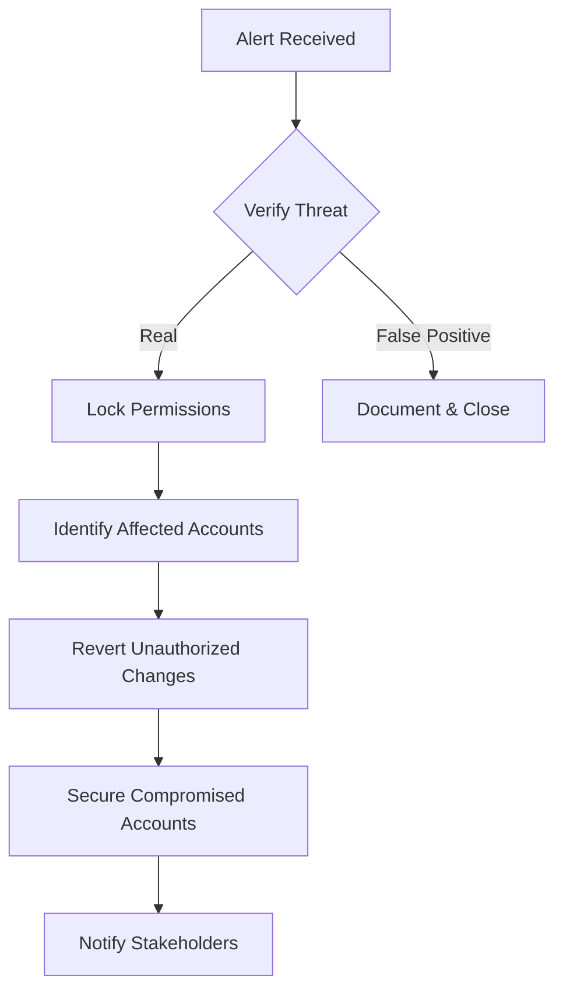
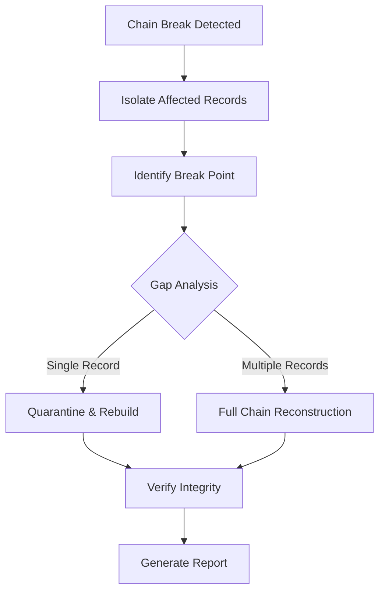

````markdown
# Incident Response Playbook — Security Bot

**Document:** DOC7  
**Status:** COMPLETE  
**Sprint:** 4 (December 2025)  
**Last Updated:** 2025-12-06

---

## Purpose

This playbook provides step-by-step response procedures for security incidents affecting the Discord bot infrastructure. Each scenario includes detection triggers, severity classification, response actions, and post-incident activities.

---

## Incident Severity Levels

| Level | Name | Response Time | Example |
|-------|------|---------------|---------|
| **P1** | Critical | < 15 min | Mass unauthorized access, data breach |
| **P2** | High | < 1 hour | Permission escalation, integrity violation |
| **P3** | Medium | < 4 hours | Rate limit abuse, suspicious activity |
| **P4** | Low | < 24 hours | Configuration drift, minor anomaly |

---

## Scenario 1: Mass Permission Escalation

### Detection Triggers
- Multiple users gaining admin roles within short timeframe
- Baseline violation: >10 role changes/hour (normal: 2-3/hour)
- Alert from `SecurityEventBus.THREAT` channel
- PagerDuty notification (P1 Critical)

### Severity: P1 Critical

### Immediate Response (< 15 min)



**Step 1: Verify the Threat**
```bash
# Check recent role changes
npm run db:cli -- query "
  SELECT * FROM role_change_audit 
  WHERE timestamp > NOW() - INTERVAL '1 hour' 
  AND authorized = false
  ORDER BY timestamp DESC
"

# Count escalations per user
npm run db:cli -- query "
  SELECT member_id, COUNT(*) as changes 
  FROM role_change_audit 
  WHERE timestamp > NOW() - INTERVAL '1 hour'
  GROUP BY member_id 
  HAVING COUNT(*) > 3
"
```

**Step 2: Lock Permissions**
```bash
# Enable emergency lockdown mode
/ops security lockdown enable --reason "Mass escalation incident"

# Disable role change commands temporarily
/ops security commands disable role_add role_remove
```

**Step 3: Identify & Revert**
```bash
# List all unauthorized changes
/ops security audit query --filter unauthorized --since 1h

# Bulk revert unauthorized changes
/ops security roles revert --since 1h --unauthorized-only --dry-run
/ops security roles revert --since 1h --unauthorized-only --confirm
```

**Step 4: Secure Accounts**
- Force re-authentication for affected users
- Check for compromised bot tokens
- Review OAuth application authorizations

### Recovery Actions

1. **Generate incident report**
   ```bash
   /ops security audit export --incident INC-2025-001 --format markdown
   ```

2. **Update baselines** to detect similar patterns
   ```bash
   npm run ops:security:baseline-update --guild <guild-id>
   ```

3. **Review and strengthen** rate limits
4. **Conduct post-incident review** within 48 hours

### Post-Incident Checklist
- [ ] All unauthorized changes reverted
- [ ] Incident timeline documented
- [ ] Root cause identified
- [ ] Preventive measures implemented
- [ ] Stakeholders notified
- [ ] Post-mortem scheduled

---

## Scenario 2: Integrity Chain Break

### Detection Triggers
- Hash chain validation failure in `role_change_audit`
- Integrity sweep alert: `HASH_CHAIN_VIOLATION`
- Checksum mismatch on security records

### Severity: P2 High

### Immediate Response (< 1 hour)



**Step 1: Locate the Break**
```bash
# Run chain validation
npm run ops:security:validate-chain --table role_change_audit --verbose

# Output example:
# Chain validation FAILED
# Break detected at record: rca_a1b2c3d4
# Expected hash: abc123...
# Actual hash: def456...
# Records affected: 15
```

**Step 2: Quarantine Affected Records**
```bash
# Mark records for investigation
npm run db:cli -- query "
  UPDATE role_change_audit 
  SET integrity_status = 'QUARANTINED'
  WHERE id >= 'rca_a1b2c3d4'
  AND integrity_status != 'VERIFIED'
"
```

**Step 3: Analyze Cause**
```bash
# Check for tampering indicators
/ops security threats list --type INTEGRITY_VIOLATION --since 24h

# Review database logs
npm run db:cli -- query "
  SELECT * FROM security_events 
  WHERE event_type = 'DATABASE_WRITE'
  AND timestamp BETWEEN '2025-12-06 10:00:00' AND '2025-12-06 11:00:00'
"
```

**Step 4: Rebuild Chain**
```bash
# Reconstruct from verified backup
npm run ops:security:chain-rebuild --table role_change_audit \
  --from-backup daily_2025_12_05 \
  --verify-discord

# Verify reconstruction
npm run ops:security:validate-chain --table role_change_audit
```

### Recovery Actions

1. **Document gap analysis** — What data may be missing/altered?
2. **Cross-reference with Discord** — Verify against Discord's actual state
3. **Review access logs** — Who had database access?
4. **Strengthen monitoring** — Add alerting for early detection

---

## Scenario 3: Rate Limit Abuse / DoS Attempt

### Detection Triggers
- Rate limiter rejecting >90% of requests from single source
- Alert: `RATE_LIMIT_EXCEEDED` with `CRITICAL` severity
- Unusual command pattern (>100 requests/minute)

### Severity: P3 Medium

### Immediate Response (< 4 hours)

**Step 1: Identify Abuser**
```bash
# Check rate limit violations
npm run db:cli -- query "
  SELECT 
    user_id, 
    COUNT(*) as violations,
    MAX(timestamp) as last_violation
  FROM rate_limit_events 
  WHERE timestamp > NOW() - INTERVAL '1 hour'
  GROUP BY user_id 
  ORDER BY violations DESC 
  LIMIT 10
"
```

**Step 2: Apply Temporary Block**
```bash
# Block specific user
/ops security ratelimit block --user <user-id> --duration 24h --reason "DoS attempt"

# Or IP-based block (if available)
/ops security ratelimit block --pattern "suspicious" --duration 4h
```

**Step 3: Analyze Pattern**
```bash
# Get command distribution
/ops security audit query --user <user-id> --commands --since 1h

# Check for coordinated attack
npm run db:cli -- query "
  SELECT 
    command,
    COUNT(*) as count,
    COUNT(DISTINCT user_id) as unique_users
  FROM security_events
  WHERE timestamp > NOW() - INTERVAL '1 hour'
  AND event_type = 'COMMAND_EXECUTED'
  GROUP BY command
  ORDER BY count DESC
"
```

**Step 4: Adjust Limits if Needed**
```bash
# Temporarily reduce rate limits
/ops security ratelimit configure --tier default --max-tokens 50 --refill-rate 5

# After incident, restore
/ops security ratelimit configure --tier default --reset-to-defaults
```

### Recovery Actions

1. Review if legitimate user was impacted
2. Consider adding user to monitoring watchlist
3. Update rate limit thresholds if too permissive
4. Document attack pattern for threat intelligence

---

## Scenario 4: Unauthorized Bot Token Access

### Detection Triggers
- Bot actions without corresponding user command
- Login from unexpected IP/region
- Discord audit log shows bot actions admin didn't initiate

### Severity: P1 Critical

### Immediate Response (< 15 min)

**Step 1: Confirm Compromise**
```bash
# Check for unexpected bot actions
/ops security audit query --actor-type BOT --since 24h

# Compare with expected automated actions
npm run ops:security:compare-bot-actions --expected-file config/expected-bot-actions.json
```

**Step 2: Rotate Token IMMEDIATELY**
```bash
# 1. Go to Discord Developer Portal
# 2. Regenerate bot token
# 3. Update secrets
pwsh -File scripts/rotate-bot-token.ps1

# 4. Restart bot with new token
npm run render:restart -- --service Infinity-Gauntlet
```

**Step 3: Assess Damage**
```bash
# List all bot actions during compromise window
npm run db:cli -- query "
  SELECT * FROM security_events 
  WHERE actor_type = 'BOT'
  AND timestamp BETWEEN '<compromise_start>' AND '<compromise_end>'
  ORDER BY timestamp
"

# Check for data exfiltration
/ops security audit export --since 24h --full-details
```

**Step 4: Notify Discord**
- Report compromised application via Discord's Trust & Safety
- Document incident for compliance

### Recovery Actions

1. **Audit all secrets** — Check for other exposed credentials
2. **Review code** — How was token exposed?
3. **Update deployment** — Ensure secrets aren't in logs/repos
4. **Enable token alerts** — Monitor for future unauthorized usage

---

## Scenario 5: Data Integrity Violation (Checksum Mismatch)

### Detection Triggers
- Checksum verification failed on record read
- Alert: `CHECKSUM_MISMATCH` from integrity service
- Scheduled sweep found inconsistent records

### Severity: P2 High

### Immediate Response (< 1 hour)

**Step 1: Isolate Affected Records**
```bash
# Find all failed checksums
npm run ops:security:integrity-scan --table security_events --verify-checksums

# Output:
# Scanning security_events...
# Total records: 15,423
# Valid: 15,418
# Invalid: 5
# Invalid IDs: se_001, se_002, se_003, se_004, se_005
```

**Step 2: Quarantine and Flag**
```bash
# Mark as quarantined
npm run db:cli -- query "
  UPDATE security_events 
  SET integrity_status = 'QUARANTINED',
      integrity_notes = 'Checksum mismatch detected 2025-12-06'
  WHERE id IN ('se_001', 'se_002', 'se_003', 'se_004', 'se_005')
"
```

**Step 3: Cross-Reference Original**
```bash
# Check if original data exists in backups
npm run ops:restore --table security_events \
  --ids "se_001,se_002,se_003,se_004,se_005" \
  --from-backup daily_latest \
  --dry-run

# Compare original vs current
npm run ops:diff --backup daily_latest --ids "se_001,se_002,se_003,se_004,se_005"
```

**Step 4: Determine Cause**
- Database corruption?
- Manual edit?
- Application bug?
- Malicious tampering?

### Recovery Actions

1. **Restore from backup** if original data available
2. **Re-sign records** if data verified correct but signature invalid
3. **Document** what data may have been altered
4. **Review access** — Who could have modified records?

---

## Scenario 6: Suspicious Login Pattern

### Detection Triggers
- Admin access from new IP/region
- Multiple failed authentication attempts
- Access outside normal hours

### Severity: P3 Medium

### Response Procedure

**Step 1: Verify Legitimacy**
```bash
# Check recent admin actions
/ops security audit query --role admin --since 24h

# Get access patterns
npm run db:cli -- query "
  SELECT 
    user_id,
    ip_address,
    user_agent,
    timestamp
  FROM admin_access_log
  WHERE timestamp > NOW() - INTERVAL '24 hours'
  ORDER BY timestamp DESC
"
```

**Step 2: Contact User**
- If legitimate: Document and whitelist new access pattern
- If unauthorized: Proceed to account lockdown

**Step 3: Lockdown if Needed**
```bash
# Temporarily revoke admin access
/ops security roles remove --user <user-id> --role admin --reason "Suspicious access investigation"

# Enable 2FA requirement (if applicable)
/ops security requirements set --role admin --mfa required
```

---

## Post-Incident Procedures

### Immediate (< 24 hours)
- [ ] Incident documented in tracking system
- [ ] Affected parties notified
- [ ] Temporary mitigations in place
- [ ] Evidence preserved

### Short-term (< 1 week)
- [ ] Root cause analysis complete
- [ ] Post-mortem meeting held
- [ ] Permanent fixes implemented
- [ ] Documentation updated

### Long-term (< 1 month)
- [ ] Process improvements identified
- [ ] Training updated if needed
- [ ] Monitoring enhanced
- [ ] Playbook updated with lessons learned

---

## Escalation Contacts

| Role | Contact | When to Escalate |
|------|---------|------------------|
| **Primary On-Call** | @DripTVDD | All P1/P2 incidents |
| **Database Admin** | Database Team | Data corruption, integrity issues |
| **Security Lead** | Security Team | Potential breach, unauthorized access |
| **Discord Support** | Discord Trust & Safety | Bot compromise, ToS violations |

---

## Appendix: Common Commands Quick Reference

```bash
# Check system health
/ops security health

# View recent events
/ops security status --verbose

# List active threats
/ops security threats list --status active

# Export audit trail
/ops security audit export --format json --since 7d

# Run integrity check
npm run ops:security:integrity-check --full

# Validate hash chains
npm run ops:security:validate-chain --all-tables

# View rate limit status
/ops security ratelimit status

# Emergency lockdown
/ops security lockdown enable --reason "Incident response"

# Emergency unlock
/ops security lockdown disable --reason "Incident resolved"
```

---

**Document Version:** 1.0  
**Review Cadence:** Quarterly  
**Next Review:** 2025-03-06

````