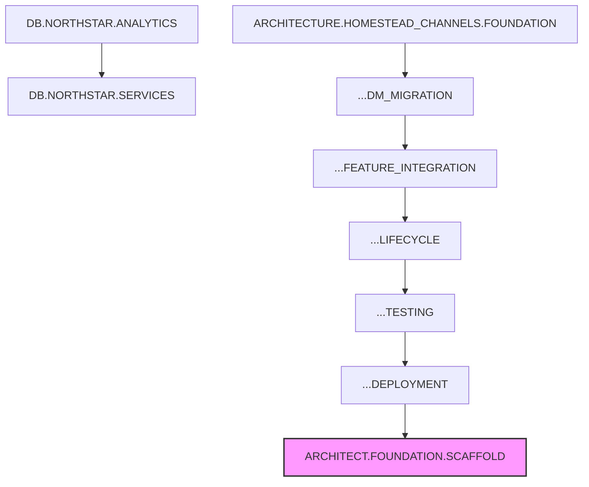

# Infinity-G-Architect — Task Breakdown

> **Parent Project:** docs/projects/architect-gui/README.md  
> **Status:** DEFERRED (awaiting Phase 17-18 completion)  
> **Created:** 2025-12-03

---

## Task Queue (All PROPOSED - Not Yet Scheduled)

### Phase 1: Foundation

```yaml
- id: ARCHITECT.FOUNDATION.SCAFFOLD
  title: Project scaffold (Vite + React + TypeScript)
  status: PROPOSED
  depends_on: [ARCHITECTURE.HOMESTEAD_CHANNELS.DEPLOYMENT]
  acceptance_criteria:
    - Initialize new repository Infinity-G-Architect
    - Setup Vite with React 18 + TypeScript
    - Configure ESLint, Prettier, Husky
    - Add base dependencies (react-flow, zustand, tailwindcss)
    - Create basic folder structure per architecture doc
    - Verify dev server runs without errors
  estimated_hours: 4
  specialists: [ai_coding (lead), architecture]

- id: ARCHITECT.FOUNDATION.LAYOUT
  title: Basic layout components (sidebar, canvas, toolbar)
  status: PROPOSED
  depends_on: [ARCHITECT.FOUNDATION.SCAFFOLD]
  acceptance_criteria:
    - Create Sidebar component with file tree placeholder
    - Create main Canvas area for React Flow
    - Create Toolbar with action buttons
    - Create StatusBar for Git status
    - Implement responsive layout with CSS Grid
    - Add shadcn/ui base components
  estimated_hours: 6
  specialists: [ai_coding (lead), documentation]

- id: ARCHITECT.FOUNDATION.PARSERS
  title: File parsers (render.yaml, package.json)
  status: PROPOSED
  depends_on: [ARCHITECT.FOUNDATION.SCAFFOLD]
  acceptance_criteria:
    - Create YAML parser for render.yaml
    - Create JSON parser for package.json
    - Extract service definitions from render.yaml
    - Extract project metadata from package.json
    - Handle parse errors gracefully
    - Write unit tests for parsers
  estimated_hours: 8
  specialists: [ai_coding (lead), architecture]

- id: ARCHITECT.FOUNDATION.DIAGRAM
  title: Static architecture diagram (read-only)
  status: PROPOSED
  depends_on: [ARCHITECT.FOUNDATION.LAYOUT, ARCHITECT.FOUNDATION.PARSERS]
  acceptance_criteria:
    - Render service nodes from parsed render.yaml
    - Show database node for PostgreSQL
    - Draw edges between connected services
    - Implement node click → details panel
    - Add zoom/pan controls
    - Style nodes by service type (web/worker/cron)
  estimated_hours: 10
  specialists: [ai_coding (lead), architecture, documentation]
```

### Phase 2: Editing Capabilities

```yaml
- id: ARCHITECT.EDIT.SERVICE_EDITOR
  title: Service configuration editor
  status: PROPOSED
  depends_on: [ARCHITECT.FOUNDATION.DIAGRAM]
  acceptance_criteria:
    - Create ServiceEditor panel component
    - Edit service name, type, build command
    - Edit environment variables
    - Edit health check settings
    - Validate inputs before save
    - Show unsaved changes indicator
  estimated_hours: 8
  specialists: [ai_coding (lead), architecture]

- id: ARCHITECT.EDIT.SCHEMA_VISUALIZER
  title: Prisma schema visualizer
  status: PROPOSED
  depends_on: [ARCHITECT.FOUNDATION.DIAGRAM]
  acceptance_criteria:
    - Create Prisma schema parser
    - Render models as table nodes
    - Show fields with types
    - Draw relations between models
    - Click model → show full definition
    - Read-only initially (editing in Phase 2b)
  estimated_hours: 12
  specialists: [ai_coding (lead), database, architecture]

- id: ARCHITECT.EDIT.CODE_EDITOR
  title: Monaco code editor integration
  status: PROPOSED
  depends_on: [ARCHITECT.FOUNDATION.LAYOUT]
  acceptance_criteria:
    - Integrate Monaco Editor component
    - Support TypeScript, YAML, JSON, Prisma syntax
    - Implement file open from tree
    - Add save functionality (Ctrl+S)
    - Show line numbers, minimap
    - Highlight unsaved changes
  estimated_hours: 6
  specialists: [ai_coding (lead)]

- id: ARCHITECT.EDIT.FILE_OPERATIONS
  title: File read/write operations
  status: PROPOSED
  depends_on: [ARCHITECT.EDIT.CODE_EDITOR]
  acceptance_criteria:
    - Implement file read service
    - Implement file write service
    - Handle file encoding (UTF-8)
    - Create backup before write
    - Handle write conflicts
    - Add error handling for permissions
  estimated_hours: 6
  specialists: [ai_coding (lead), security]
```

### Phase 3: Git Integration

```yaml
- id: ARCHITECT.GIT.STATUS
  title: Git status display
  status: PROPOSED
  depends_on: [ARCHITECT.EDIT.FILE_OPERATIONS]
  acceptance_criteria:
    - Show current branch in status bar
    - List changed files (staged/unstaged)
    - Show file status icons (M/A/D/?)
    - Refresh on file system changes
    - Show remote tracking info
  estimated_hours: 6
  specialists: [ai_coding (lead), devops]

- id: ARCHITECT.GIT.DIFF_VIEWER
  title: Diff viewer for changes
  status: PROPOSED
  depends_on: [ARCHITECT.GIT.STATUS]
  acceptance_criteria:
    - Show side-by-side diff
    - Highlight added/removed lines
    - Support inline diff mode
    - Navigate between changes
    - Copy diff to clipboard
  estimated_hours: 8
  specialists: [ai_coding (lead)]

- id: ARCHITECT.GIT.COMMIT_PUSH
  title: Commit and push workflow
  status: PROPOSED
  depends_on: [ARCHITECT.GIT.STATUS]
  acceptance_criteria:
    - Stage/unstage individual files
    - Stage all changes button
    - Commit message input with validation
    - Commit button with confirmation
    - Push to remote with progress
    - Pull from remote with merge handling
  estimated_hours: 10
  specialists: [ai_coding (lead), devops, security]

- id: ARCHITECT.GIT.GITHUB_AUTH
  title: GitHub OAuth authentication
  status: PROPOSED
  depends_on: [ARCHITECT.GIT.COMMIT_PUSH]
  acceptance_criteria:
    - Implement GitHub OAuth flow
    - Secure token storage (keychain/credential manager)
    - Token refresh handling
    - Logout functionality
    - Show authenticated user info
  estimated_hours: 8
  specialists: [ai_coding (lead), security]
```

### Phase 4: Advanced Features

```yaml
- id: ARCHITECT.ADVANCED.DEPLOY_TRIGGER
  title: One-click Render deployment
  status: PROPOSED
  depends_on: [ARCHITECT.GIT.COMMIT_PUSH]
  acceptance_criteria:
    - Integrate Render API
    - Show deployment status
    - Trigger deploy for specific service
    - Show deployment logs
    - Handle deployment errors
  estimated_hours: 8
  specialists: [ai_coding (lead), devops]

- id: ARCHITECT.ADVANCED.LOG_VIEWER
  title: Render log streaming
  status: PROPOSED
  depends_on: [ARCHITECT.ADVANCED.DEPLOY_TRIGGER]
  acceptance_criteria:
    - Stream logs from Render API
    - Filter by service
    - Search within logs
    - Auto-scroll toggle
    - Download log export
  estimated_hours: 6
  specialists: [ai_coding (lead), devops]

- id: ARCHITECT.ADVANCED.DB_BROWSER
  title: Database query browser
  status: PROPOSED
  depends_on: [ARCHITECT.EDIT.SCHEMA_VISUALIZER]
  acceptance_criteria:
    - Connect to database (read-only)
    - Execute SELECT queries
    - Display results in table
    - Export results to CSV
    - Query history
  estimated_hours: 10
  specialists: [ai_coding (lead), database, security]

- id: ARCHITECT.ADVANCED.POLISH
  title: UI polish and keyboard shortcuts
  status: PROPOSED
  depends_on: [ARCHITECT.ADVANCED.LOG_VIEWER]
  acceptance_criteria:
    - Implement keyboard shortcut system
    - Add command palette (Ctrl+Shift+P)
    - Theme support (light/dark)
    - Loading states and skeletons
    - Error boundaries
    - Accessibility audit
  estimated_hours: 8
  specialists: [ai_coding (lead), documentation]
```

### Phase 5: Desktop App (Optional)

```yaml
- id: ARCHITECT.DESKTOP.ELECTRON
  title: Electron wrapper
  status: PROPOSED
  depends_on: [ARCHITECT.ADVANCED.POLISH]
  acceptance_criteria:
    - Setup Electron with Vite
    - Configure main/renderer processes
    - Native file system access
    - System tray integration
    - Window state persistence
  estimated_hours: 8
  specialists: [ai_coding (lead), devops]

- id: ARCHITECT.DESKTOP.BUILD
  title: Cross-platform builds
  status: PROPOSED
  depends_on: [ARCHITECT.DESKTOP.ELECTRON]
  acceptance_criteria:
    - Windows installer (NSIS)
    - macOS DMG
    - Linux AppImage
    - Auto-update mechanism
    - Code signing (optional)
  estimated_hours: 10
  specialists: [devops (lead), ai_coding]
```

---

## Summary Statistics

| Phase | Tasks | Est. Hours | Specialists |
|-------|-------|------------|-------------|
| Phase 1: Foundation | 4 | 28 | AI Coding, Architecture, Documentation |
| Phase 2: Editing | 4 | 32 | AI Coding, Architecture, Database, Security |
| Phase 3: Git | 4 | 32 | AI Coding, DevOps, Security |
| Phase 4: Advanced | 4 | 32 | AI Coding, DevOps, Database, Documentation |
| Phase 5: Desktop | 2 | 18 | AI Coding, DevOps |
| **TOTAL** | **18** | **142** | |

**Estimated Duration:** 10-12 weeks (part-time), 4-5 weeks (full-time)

---

## Dependencies on Current Work



**Critical Path:** Homestead channel deployment must complete before Architect work begins.

---

**Document Version:** 1.0  
**Last Updated:** 2025-12-03
